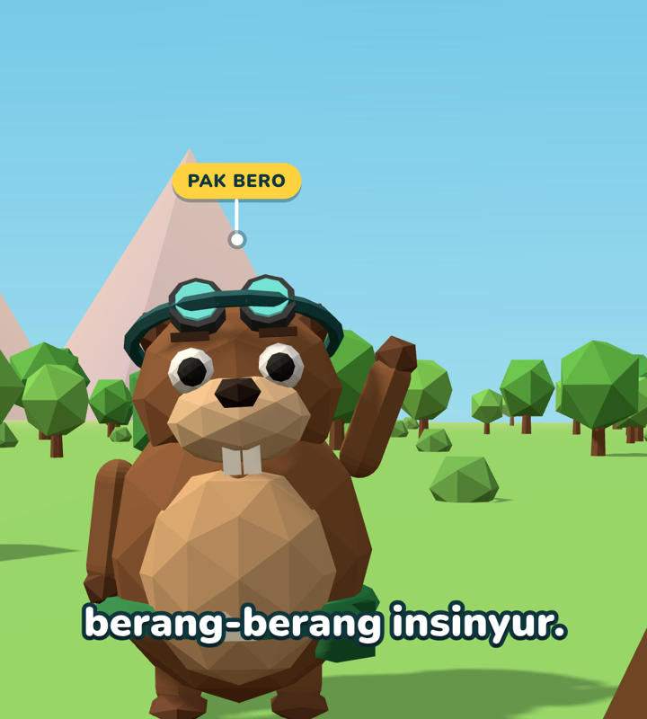

# Desain: Pak Bero & Gaya Visual

Sumber kebenaran desain ada di kode (`engine/bero.js`, `engine/kit.js`, `engine/index.html`).
Dokumen ini ringkasannya, supaya desain tetap konsisten di setiap episode.

## Foto profil

`avatar-wave-teal.png` (utama), `avatar-happy-peach.png`, `avatar-wave-sky.png`, 1080x1080, dibuat ulang dengan `node tools/avatar.mjs`.

## Banner YouTube

`banner-youtube.png` (2560x1440). Teks & maskot di area aman 1546x423. Buat ulang: `node tools/banner.mjs` (`--guide` untuk menampilkan garis area aman).

## Cover/thumbnail video

`node tools/cover.mjs <frame.png> "Judul|*kata kuning*" "Tag merah" out/<ep>-cover.jpg`, frame dari `render.mjs --still <t> --scale 2 --clean`. Judul & tag sengaja berada di 15–80% tinggi supaya aman saat grid IG memotong ke 3:4.

## Pak Bero (berang-berang insinyur)

| Bagian | Detail | Warna |
|---|---|---|
| Bulu | Low-poly, badan bulat | `#8d5a33`, gelap `#6b4024` |
| Perut & moncong | Lebih terang | `#dcae7c`, `#e8c194` |
| Gigi | 2 gigi depan besar (ciri berang-berang) | `#fffaf0` |
| **Kacamata pelindung** | Di dahi, lensa toska, tali toska tua | lensa `#6fe0dc`, tali `#1f5f63` |
| **Sabuk alat** | Sabuk hijau + kantong + gesper | `#2f8f4e`, `#1f6b39` |
| Ekor | Pipih, gelap | `#4a2f1d` |

**Sengaja dihindari** (supaya tidak mirip akun referensi): helm kuning, rompi oranye, manusia.

**Animasi tersedia** (`bero.pose(t, anim)`): `idle`, `wave`, `panic`, `happy`, `walk`, `point`, `slap` (menambal/membangun), `think`, `sad`, `carry`.

**Sifat:** optimis, gampang panik saat gagal, lalu bangkit dan coba solusi baru. Di topik tragedi nyata (mis. Situ Gintung) Pak Bero tenang/sedih, **tidak pernah konyol**.

## Palet dunia

| Token | Hex | Dipakai untuk |
|---|---|---|
| skyTop / skyMid / skyLow | `#6ec6e6` / `#a9e0ef` / `#ffe2b8` | Langit gradasi biru → peach (sore) |
| grass | `#8fd16a` | Rumput |
| cliff | `#b0703f` | Tebing |
| water | `#27b3ac` | Air toska |
| hills | `#b7a5dd` / `#cdbfeb` | Bukit pastel lavender di kejauhan (bukan gunung salju) |
| leaf | `#5fbf4a` dst | Pohon **bulat** (bukan pinus) |
| arrow | `#ffd23f` | Panah gaya |

## Teks layar

- **Font:** Nunito 900 (dari `@fontsource/nunito`, terbundel, tidak perlu internet)
- **Subtitle:** putih dengan outline biru tua `#10363d`, 2–3 kata per potongan, muncul per kata (pop)
  - `*kata*` di naskah → **kuning** `#ffd23f` (istilah)
  - `!kata!` di naskah → **merah** `#ff5a5f` (kegagalan)
- **Label istilah:** pil **putih** membulat + garis penunjuk + titik (varian kuning/merah). Bukan kotak kuning seperti referensi.
- **Watermark:** kiri atas, avatar bulat cokelat + handle dari `brand.json`.
- **Kartu info:** kotak putih membulat di atas, untuk fakta/tanggal.
